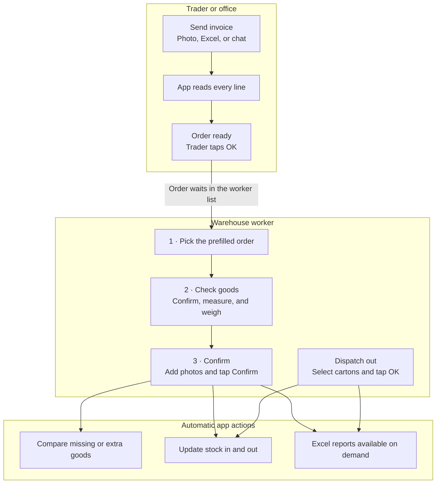
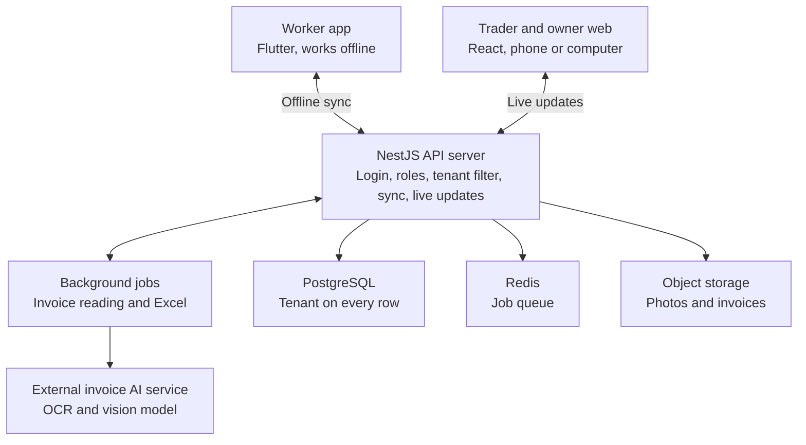

# Jahez Warehouse System - System Design v2

Markdown conversion of the [original Word requirements](Requirments.docx). See the [approved technology stack](../tech-stack/README.md) for later architecture and deployment decisions.

## Contents

- [Purpose and scope](#purpose-and-scope)
- [Who does what](#who-does-what)
- [Core flow](#core-flow)
- [Worker screens](#worker-screens)
- [What the app does automatically](#what-the-app-does-automatically)
- [Invoice formats seen](#invoice-formats-seen)
- [Rules](#rules)
- [Data model](#data-model)
- [Architecture](#architecture)
- [Reports and Excel exports](#reports-and-excel-exports)
- [API](#api)
- [Multi-tenant design](#multi-tenant-design)
- [Devices and scale](#devices-and-scale)
- [Tech stack](#tech-stack)
- [Phases](#phases)
- [Risks and open questions](#risks-and-open-questions)

## Purpose and scope

A warehouse app where the app does the work and people only confirm. It reads the supplier invoice, compares it with what arrives, tracks stock, files costs, and exports everything to Excel, so workers and traders stop typing the same data repeatedly.

### In scope (Phase 1)

1. Receiving goods from suppliers, against an order or invoice that the app reads automatically.
2. Recording goods received and goods dispatched.
3. Warehouse inventory: what is in stock, for which customer, where.
4. Costs and expenses, each stored with its invoice photo.
5. Reports and records exported to Excel at any time.

**Out of scope for now:** accounting integration, customer billing and statements, customer portal, containers, labels and Bluetooth scales. The Excel exports are built so the client's accounting system can use them later.

### Design principles

- **Three taps, almost no typing** for the worker.
- **Automation first:** if the app can read it, calculate it or compare it, a person never types it.
- **A person confirms** anything the app is unsure about; nothing is guessed silently.
- **Own warehouse first,** then other customers: every record carries a tenant from day one, so the same app can later serve many customers with separate data.

## Who does what

Each person does only the part a machine cannot: confirm, measure, photograph.

| Role | Device | Does | Never has to |
| --- | --- | --- | --- |
| Warehouse worker | Phone (Android first) | Picks the order, taps OK or corrects a number, measures, weighs, takes photos, confirms; records dispatch | Type product names, quantities, prices or totals; see prices |
| Trader / office | Phone or web | Sends the invoice (photo, Excel, or WhatsApp share), glances at the order the app built, resolves flagged differences, uploads expense invoices, exports reports | Re-enter invoice lines; calculate totals; compare by hand |
| Owner | Web + phone | Sees stock, receipts, dispatches, differences and expenses live; manages users; exports anything | — |

Workers do not see prices or costs. Every action is logged with user and time.

## Core flow

The trader sends an invoice, the app builds the order, the worker confirms what arrived, and stock and reports follow without more typing.

*core flow · invoice to stock and reports*

Dispatch works the same way in reverse: the worker tick’s cartons from stock and the app updates stock and the packing list. Expenses follow the same pattern: the trader photographs the invoice, the app reads amount, date and supplier, and the trader taps OK.

## Worker screens

Receiving is three big buttons; dispatch is two. Large text, large buttons, Arabic, English or Chinese, and every screen shows one job only.

### Receiving goods (3 steps)

1. **Pick the order.** The worker sees a list of waiting orders (supplier, customer, expected cartons). Tapping one opens it with every line already filled in from the invoice. If no order exists, a photo of the delivery note creates one.
2. **Check the goods.** Each line shows what should arrive. The worker taps the green OK, or taps the number and corrects it. Then the worker enters the carton size and weight (or keeps the size the app read from the invoice), and CBM appears automatically. Important goods ask for a photo of each piece.
3. **Photos and confirm.** The worker takes a few photos, sees one summary (expected, received, differences), and taps Confirm. Stock updates, and any difference goes to the trader automatically.

### Dispatching goods (2 steps)

1. **Pick the customer mark.** The app lists the cartons in stock for that customer.
2. **Tick what leaves and confirms.** Stock goes down, and the app creates the packing list.

### Simplicity rules

- No free typing except corrections to numbers; text fields are filled by the app.
- The worker can always undo the last step before confirming.
- Works offline; the screen shows a small "saved, will sync" mark instead of an error.
- Differences never block the truck: the worker confirms that the trader resolves later.

## What the app does automatically

This is the core of the product. Each row is work a person does by hand today.

| Task | What the app does | Person's part |
| --- | --- | --- |
| Read the invoice | Extracts supplier, buyer, date, and for each line: product name, size, cartons, quantity per carton, quantity, weight, CBM, unit price, total, deposit | Glances at the result; fixes only fields marked uncertain |
| Build the order | Creates the order and links it to the supplier and customer mark; reuses known suppliers and products | Confirms |
| Check the invoice itself | Verifies quantity = cartons × per carton, amount = quantity × price, line sums = invoice totals; flags a missing deposit or delivery date and dates that do not fit together; works out cartons from quantity ÷ per carton when the sheet has no carton column; checks balance = total − deposit + freight | Decides on flagged items |
| Compare delivery with order | Matches received lines to ordered lines; flags missing, extra, wrong item, damaged, and CBM or weight outside tolerance | Resolves flagged differences |
| Calculate CBM and totals | CBM from size and cartons; receipt totals | None |
| Update inventory | Adds stock on receipt, removes it on dispatch, keeps a history of every movement | None |
| File costs | Reads an expense invoice photo (amount, date, supplier, category) and attaches it to the expense | Confirms and picks the customer or order it belongs to |
| Reports | Builds Excel files from the records on demand | Taps Export |
| Keep evidence | Stores every photo against the receipt, line or piece, with time and worker | Takes the photos |

Every automatic result shows a confidence mark. Low confidence means a person must confirm before the order is used.

## Invoice formats seen

Six real samples from six shops (22 Nov) arrived in five different formats. The client confirms it can be any format: Excel, screenshots, or handwritten records.

| Shop | Format | Cartons shown | CBM and weight | Reading |
| --- | --- | --- | --- | --- |
| Yue Mei Li Hardware | Screenshot of a printed system order, Chinese | Only in remarks ("50箱") | No | Easy |
| Fengshun Security | Photo of a handwritten carbon form, sideways | Handwritten | No | Hard |
| Ou Gao Bathroom | Photo of a printed sheet with handwritten item numbers and sizes | Yes | Printed, plus handwritten sizes | Medium |
| Bang Bo Sanitary Ware | Screenshot of an Excel sheet | Yes | Yes, per carton and total | Easy |
| B-Think Hardware | Tilted photo of a handwritten carbon form, a business card on top, one crossed-out line | Handwritten | No | Hard |
| Dou Man Sanitary Ware | PDF export of an Excel sheet | Yes | CBM per carton and total | Easy |

What this means for the app:

- **Printed, Excel and PDF sheets (3 of 6) can be read reliably.** Handwritten forms (2 of 6) cannot. For those the app shows the photo beside the order form, pre-fills what it can, and the person fixes only the few numbers it is unsure of. The ordinary manual form is always the fallback.
- **Most fields are optional.** Only the supplier, a product description, quantity and price are always present. Cartons, CBM, weight, deposit and delivery date are often missing, so the app works out cartons from quantity ÷ pieces per carton, and the worker supplies CBM and weight when receiving.
- **The arithmetic checks work.** On every readable sample, quantity × price matches the line amount and the totals add up, so a typo in a future invoice will be caught.
- **Extra lines and dates need checking too.** The Bang Bo sheet adds a 150 RMB freight line, and its balance (4,942) is total 6,792 − deposit 2,000 + freight 150. Its deposit date (20 Oct) is also after its delivery date (20 Jan), which a date check would flag. The Dou Man sheet has no deposit or payment mode filled in.
- **Brand comes from the front shipping mark.** The same SONET logo appears on three shops' sheets, so brand is stored on each order line and shown in stock.

## Rules

**CBM.** Calculated on the phone and the server, never typed. Illustrative example: 60 × 45 × 9 cm × 6 cartons = 0.146 CBM. The paper voucher #0000322 leaves the size column empty and records only the total of 0.146 CBM.

$$
\text{CBM} = \frac{L_{cm} \times W_{cm} \times H_{cm}}{1{,}000{,}000} \times \text{cartons}
$$

### Comparing delivery with the order

| Finding | Rule |
| --- | --- |
| Missing | received cartons < ordered cartons |
| Extra | received cartons > ordered cartons |
| Wrong item | received line matches no ordered line |
| Damaged | worker marks damaged and takes a photo |
| CBM or weight off | measured value differs from the order by more than the tolerance |

Default tolerance: 3% for CBM, 5% for weight, adjustable by the owner. A finding creates an alert for the trader immediately; the receipt is still saved so the truck is not held. An order stays "Partly received" until every line is received or the trader closes it.

### Inventory

- Stock is never edited directly. It is the sum of movements: receipt (+), dispatch (−), adjustment (±, with a reason and a photo).
- Stock is tracked per supplier, brand and customer mark, as total cartons. No shelf or area locations are used (client's answer, 22 Nov).
- Dispatch cannot take out more than is in stock; the app shows the shortage instead.
- Goods age is counted from the receipt date, so long-stored goods are easy to list.

**Expenses.** An expense has an amount, date, category (for example transport, labor, handling, rent), an optional link to a customer or order, and an invoice photo. It cannot be saved without the photo unless the trader marks "no invoice" with a note.

## Data model

PostgreSQL with UUID keys. Every table has `tenant_id`, `created_at`, `updated_at`, `created_by` and a `version` for offline sync. Stock is derived from `stock_movements`, so it can always be audited.

| Table | Key fields | Notes |
| --- | --- | --- |
| tenants | name, plan, default language, tolerances | One per customer company; the first is the client's own |
| users | tenant_id, name, phone, role (owner/trader/worker), language | Workers get no price fields |
| parties | tenant_id, name, name_cn, type (customer/supplier), shipping_mark, phone, address | Customers and suppliers in one table |
| products | tenant_id, name_ar, name_en, name_cn, model_no, photo | Built up automatically from invoices |
| orders | tenant_id, order_no, customer_id, supplier_id, order_date, expected_date, deposit, total_amount, currency, status, source (photo/excel/manual), source_file_url | Created by invoice reading |
| order_lines | order_id, product_id, brand, size, cartons, qty_per_carton, qty, unit_price, amount, cbm, weight, confidence | One row per invoice line |
| receipts | tenant_id, receipt_no, order_id (optional), customer_id, supplier_id, received_by, received_at, status | One per delivery; an order can have several |
| receipt_lines | receipt_id, order_line_id, cartons, length_cm, width_cm, height_cm, cbm, weight_kg, condition (ok/damaged) | CBM calculated, never typed |
| findings | receipt_line_id, type (missing/extra/wrong/damaged/cbm/weight), expected, actual, status, resolved_by, note | Created by the comparison |
| stock_movements | tenant_id, supplier_id, brand, customer_id, product_id (optional), cartons, qty, cbm, kind (receipt/dispatch/adjust), ref_id | The inventory ledger |
| dispatches | tenant_id, dispatch_no, customer_id, dispatched_at, dispatched_by, destination, status | Lines hold the cartons that left |
| expenses | tenant_id, amount, currency, date, category, party_id, order_id (optional), invoice_photo_url, note | Photo required |
| photos | tenant_id, receipt_id, receipt_line_id, expense_id, url, kind, taken_by, taken_at | Files live in object storage |
| audit_log | tenant_id, user_id, entity, entity_id, action, before, after, at | Every change |

### Status values

- Order: Draft → Ready → Partly received → Received, or Cancelled.
- Receipt: Draft (offline) → Confirmed.
- Finding: Open → Resolved.

## Architecture

One backend serves the worker app and the web dashboard. Slow work such as reading invoices and building Excel files runs in the background, so screens stay fast.

Every record and file carries a tenant ID. The source diagram proposes hosting in Hong Kong or Singapore, reachable from Yiwu.

*architecture · apps, API, jobs, storage*

All rules live in the API server, so every app shows the same totals and stock.

### Invoice reading pipeline

1. The photo or Excel file is saved to object storage.
2. Excel: columns are matched by their header words in Chinese, English or Arabic, so the client's template and most shop templates import directly.
3. Photo: OCR extracts the text and table cells; a vision-capable model turns them into a fixed structure (supplier, buyer, dates, lines, totals).
4. The invoice checks run (quantity, amount, totals, deposit) and every field gets a confidence score.
5. The trader sees the order with uncertain fields highlighted and taps OK. Corrections are saved and used to read the same shop's next invoice better.

### Offline sync (worker app)

- Every record gets a UUID on the phone, so it can be created offline without clashes.
- Changes wait in a local outbox and are sent when the phone is online; the app then pulls changes made by others.
- Photos upload separately with retry, so a receipt can sync before its photos finish.
- Offline receipts show a temporary number; the final sequential number is assigned on sync.
- If trader and worker edit the same record, measurements come from the worker and commercial fields from the trader; both versions stay in the audit log.

**Live updates.** The API pushes events over WebSocket (order ready, receipt confirmed, finding raised), so the trader and owner see the warehouse as it happens.

## Reports and Excel exports

Every list in the app has an Export button, and these reports are ready-made. Layouts follow the client's existing Excel files, so nothing is reformatted afterwards, and the columns are kept clean so an accounting system can import them later.

| Report | Content | Used for |
| --- | --- | --- |
| Goods received | Receipt no, date, customer mark, supplier, items, cartons, CBM, weight, worker, photo links | Daily check, proof of receipt |
| Goods dispatched | Dispatch no, date, customer mark, items, cartons, CBM, weight; doubles as packing list | Shipping, customs |
| Current inventory | Per customer mark and product: cartons, CBM, weight, location, days in storage | Stock count, storage review |
| Stock movements | Every receipt, dispatch and adjustment with date and user | Audit |
| Order vs received | Ordered, received, difference and status per line | Disputes with suppliers |
| Expenses | Date, category, amount, linked customer or order, invoice photo link | Cost control, later accounting |
| Purchase order | The client's trilingual order sheet, with product photos | Supplier and customer copy |

Filters on every report: date range, customer mark, supplier. Exports run on the server, so a phone and a laptop produce the same file.

## API

REST under `/api/v1`, JSON, JWT login. The token carries the user, role and tenant; every query is filtered by tenant on the server. The server removes price fields from worker responses. Slow jobs (invoice reading, Excel) return a job id.

| Area | Endpoints | Purpose |
| --- | --- | --- |
| Auth | POST /auth/login, /auth/refresh | Login by phone |
| Parties | GET/POST /parties, GET/PATCH /parties/{id} | Customers and suppliers |
| Invoice reading | POST /orders/extract (photo or Excel) → job id; GET /jobs/{id} | Returns a draft order with confidence per field |
| Orders | GET/POST /orders, GET/PATCH /orders/{id}, POST /orders/{id}/confirm | Review and confirm the read order |
| Receiving | GET /orders/awaiting; POST /receipts; POST /receipts/{id}/confirm | Worker queue and receipt |
| Findings | GET /findings?status=open; PATCH /findings/{id} | Trader resolves differences |
| Dispatch | GET /stock?customer={id}; POST /dispatches; POST /dispatches/{id}/confirm | Pick from stock and ship |
| Inventory | GET /stock; GET /stock/movements; POST /stock/adjustments | Current stock and history |
| Expenses | POST /expenses/extract (photo) → job id; POST /expenses; GET /expenses | Expense with invoice photo |
| Photos | POST /uploads/presign, then PUT to storage; POST /photos | Direct upload |
| Reports | POST /exports {type, filters} → job id; GET /exports/{id}/file | Excel files |
| Sync | POST /sync/push; GET /sync/pull?since={cursor} | Offline changes from the phone |
| Live updates | WebSocket /ws | Order ready, receipt confirmed, finding raised |

## Multi-tenant design

The client plans to test in his own warehouse and later offer the app to existing customers as a paid product, each with separate data. The cheapest time to build for that is now.

- **One database, tenant column on every table.** The server adds the tenant filter to every query from the login token, so one customer can never read another's data. Row-level security in PostgreSQL enforces it again at the database.
- **Separate file folders per tenant** in object storage (`tenant_id/year/month/…`), with private expiring links.
- **Per-tenant settings:** language, tolerances, report templates, warehouse locations, logo.
- **Per-tenant users and roles.** A customer's owner manages their own workers.
- **Several warehouses per tenant:** a `warehouse_id` on receipts, stock and dispatches, so one company with two sites sees both.
- **Plans later:** a `plan` field on the tenant (users, receipts per month) is enough to start a subscription; billing itself can be added when the product is sold.
- **Growth path:** if one customer becomes very large, its data can be moved to its own database without changing the app, because every query already carries the tenant.

## Devices and scale

The pilot starts on company-supplied Android tablets, with about 100 workers and about 50 receipts a day. The product itself must run on any Android phone or iPhone, including small phones, and be published on Google Play and the App Store (client's answers, 22 Nov).

- **One app, every screen size.** One Flutter codebase for Android and iPhone. Receiving shows one job per screen, so it fits a small phone; on a tablet the order list sits beside the order lines. Screens are designed and tested on the smallest phone first.
- **Small load.** Assuming about 10 photos per receipt at 300 KB each, 50 receipts a day is about 150 MB of photos a day, roughly 55 GB a year. One server and one database are enough. Photos are compressed on the device and work on weaker cameras.
- **Shared and personal devices.** Shared tablets need fast login (a short PIN or worker code), sign-out after idle time, and every action recorded against the person who logged in. A lost device is signed out remotely, and the app keeps no data after sign-out.
- **Store publishing.** Google Play and the App Store each need a developer account in the company's name and a review before each release. Google Play is not available in mainland China, and the China App Store requires a government filing (ICP) for apps, so the client's workers in China install from both stores through a VPN, as he confirmed. The app itself must not need a VPN to run: hosting and notifications are chosen to work from China, and the server keeps working with the previous app version in case an update is delayed. A direct Android install link stays available as a backup.

## Tech stack

A small, common stack that one or two developers can build and maintain, chosen for offline phone work and hosting that works from China.

| Layer | Choice | Why |
| --- | --- | --- |
| Worker app | Flutter (Android and iPhone, phones and tablets) | One codebase, strong camera and offline support, right-to-left Arabic |
| Local storage | SQLite + a photo queue | Offline receipts and photos |
| Office web | React + TypeScript | Fast tables, filters, Excel download |
| Backend | NestJS (Node.js, TypeScript) | One language for web and server |
| Database | PostgreSQL (managed) | Relational data, tenant row-level security |
| Jobs | Redis + BullMQ | Invoice reading, Excel generation |
| Files | S3-compatible object storage (for example Alibaba OSS) | Photos, invoices, exports |
| Invoice reading | OCR tuned for Chinese + a vision-capable LLM that returns structured JSON | Reads printed and handwritten Chinese invoices; output is always confirmed by a person |
| Excel | ExcelJS with fixed templates | Exact layouts, embedded thumbnails |
| Live updates | WebSocket | Trader sees receipts as they happen |
| Hosting | Alibaba Cloud, Hong Kong or Singapore region, Docker | Reachable from Yiwu without VPN; Google and Firebase are blocked in China |

## Phases

Phase 1 gives the client everything he asked for, in his own warehouse, so he can judge it by daily use. Later phases follow what he learns.

*phases · 3 phases, 2 gates*

No dates are fixed yet: the length of the pilot depends mostly on how quickly invoice reading is tuned on his real invoices. Each gate is a decision with the client before the next phase starts.

### Phase 1 Own warehouse pilot

Deliver the requested warehouse workflows.

- Invoice reading
- Order versus delivery comparison
- Three-step receiving
- Dispatch and live stock
- Expenses with invoice photos
- Excel reports
- Android and iPhone with offline operation
- A tenant on every record

### Phase 2 Learn from real use

This phase starts after the pilot works.

- Improve invoice reading with use
- Fix issues from worker feedback
- Add accounting export formats
- Improve handwritten invoice reading
- Add more reports

### Phase 3 Offer to customers

This phase starts after the product meets the client's needs.

- Separate customer accounts
- Several warehouses per company
- Subscription plans
- Customer view of their own goods
- Store listings for customers

## Risks and open questions

### Risks

| Risk | Why it matters | How we handle it |
| --- | --- | --- |
| Invoice reading accuracy | Handwritten Chinese, photos at an angle, and many shop layouts will not read perfectly | Build and test it first on the client's real invoices; show confidence per field; a person confirms before use; improve with each corrected invoice |
| Workers not adopting it | Non-technical users abandon complicated apps | Three-step screens, large buttons, tested with real workers in week one of the pilot |
| Weak signal in the warehouse | Lost data would destroy trust | Offline-first with a visible "saved" mark; photos upload later |
| Hosting from China | Blocked services break the app | China-reachable hosting and no Google or Firebase dependency |
| Scope growth | Accounting, billing and portal requests will come | Keep them in later phases; exports are built to feed them |

### Questions and decisions

- [ ] Invoices: 6 samples received. No, more are available now; the client will send more when testing starts, and the pilot keeps every invoice it reads to tune the reading.
- [ ] Formats: any format, Excel, screenshots, PDF or handwritten (answered).
- [ ] Devices: Android and iPhone, small phones and tablets, on Google Play and the App Store (answered). Workers in China install it from both stores through a VPN (answered).
- [ ] Workers: about 100 (answered). Decision: start with one warehouse and a handful of traders; the model already supports more warehouses and users.
- [ ] Receipts: about 50 a day (answered). Decision: assume about as many orders, around 50 a day; this does not change the design.
- [ ] Several deliveries per order: yes (answered).
- [ ] Locations: not needed; only supplier name, brand name and total cartons (answered). Decision: stock also keeps the customer mark, so dispatch can pick by customer; reports can ignore it.
- [ ] Expense categories, decision: start with freight to warehouse, transport, labor, packaging, loading and handling, rent and utilities, fees, and other; the owner can add or rename categories.
- [ ] Excel files: his blank purchase order template received. Decision: no receipt or stock Excel is assumed, so we design them from the paper voucher and his purchase order columns, and adjust after the pilot.
