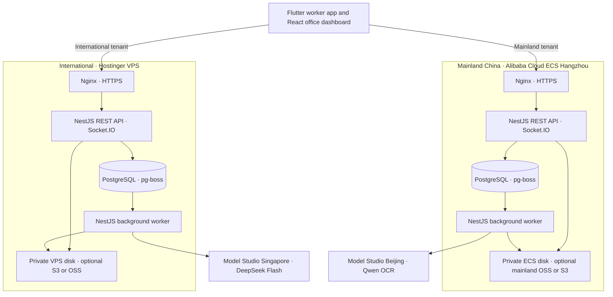

# Jahez Warehouse System Tech Stack

Jahez will use one codebase and two independent deployments. The international deployment uses the existing Hostinger VPS. The mainland China deployment uses Alibaba Cloud ECS in Hangzhou. Each deployment has its own domain, database, file storage, credentials, and backups.

[System Design v2](../Requirments%20/Requirments.docx)

## Deployment diagram

## Technology by layer

| Layer | Technology |
| --- | --- |
| Worker app | Flutter + Dart for Android and iPhone |
| Offline storage and sync | Drift + SQLite, with separate queues for receipt changes and photo uploads |
| Office dashboard | React + TypeScript + Vite, with fonts and assets served from the regional deployment |
| Backend | NestJS + Node.js LTS, with a REST API and a background worker from the same codebase |
| Authentication and permissions | JWT and role-based access for owners, traders, and workers |
| Database | PostgreSQL with row-level security, a stock movement ledger, and an audit trail |
| Background jobs | pg-boss for invoice processing and Excel exports |
| Live updates | Socket.IO over WebSocket, with REST refresh after reconnect |
| Invoice AI | Alibaba Cloud Model Studio, using DeepSeek Flash internationally and Qwen OCR in mainland China |
| Spreadsheet and PDF processing | ExcelJS for XLSX import and export. PDF.js for searchable PDF text. |
| File storage | Private persistent disk by default. S3-compatible storage and native Alibaba OSS are selectable. |
| Deployment | Docker Compose + Nginx for HTTPS and WebSocket proxying |
| Backups | Encrypted off-server backups of PostgreSQL and files, stored within the deployment's data region |

## Deployment configuration

Set these variables in each deployment's server-side `.env`. Keep database, storage, and Model Studio credentials separate for each deployment.

| Variable | International | Mainland China |
| --- | --- | --- |
| `DEPLOYMENT_PROFILE` | `international` | `cn-mainland` |
| `STORAGE_DRIVER` | `local` | `local` |
| `INVOICE_AI_PROVIDER` | `modelstudio` | `modelstudio` |
| `INVOICE_AI_REGION` | `ap-southeast-1` | `cn-beijing` |
| `INVOICE_AI_MODEL` | `deepseek-v4.1-flash-1017` | `qwen-vl-ocr-2025-11-20` |

- **Storage.** `local` uses a private, persistent Docker volume shared by the API and worker. To enable `s3` or `oss`, set the provider and its bucket, region, endpoint, and credentials, then recreate the API and worker containers. Validate the selected configuration at startup. Record the storage location and object key for each file so existing files stay accessible through their original provider. Serve files through tenant-authorized access.
- **Mainland OSS.** Use the same-region OSS internal endpoint from ECS. If direct public uploads are enabled, configure a custom OSS domain where the mainland public endpoint rules apply. [OSS network documentation](https://www.alibabacloud.com/help/en/oss/user-guide/regions-and-endpoints)
- **Regional AI.** Call Model Studio from the background worker. Parse XLSX and searchable PDFs directly. Send photos and scanned pages to the configured model, validate extracted values and arithmetic, and ask the trader to review uncertain fields. Confirm the mainland model's inference scope before processing live invoices. Alibaba's Beijing endpoint also supports models whose inference can run outside mainland China. [DeepSeek model](https://www.alibabacloud.com/help/en/model-studio/deepseek-v4-1-flash) · [Qwen OCR model](https://www.alibabacloud.com/help/en/model-studio/qwenvl-ocr) · [Beijing inference scopes](https://www.alibabacloud.com/help/en/model-studio/beijing-access-information)

## Warehouse operations and growth

- **Regional tenancy.** Each customer company has one tenant in its home region and can have multiple warehouse sites. The company invite directs users to the correct regional API. Track users, sites, and monthly receipt usage per tenant for future plans.
- **Offline receiving.** Save receipts and photos on the device and retry when connectivity returns. Keep receipt retries idempotent so a repeated sync cannot post the same stock movement twice.
- **Dispatch and live updates.** Confirm dispatch online and check stock and write the movement in one database transaction. Publish warehouse events only after the transaction commits. Scope events by tenant and warehouse, then refresh affected data when the dashboard reconnects.
- **Scaling.** Start with one API and one worker per deployment. Add workers as the invoice and export queues grow. Move PostgreSQL to a managed instance in the same region when operational needs justify it. Move active uploads to regional object storage before running application replicas across hosts.

## Mainland launch checks

1. Confirm the mainland filing entity and domain eligibility, complete applicable website and app filings, and verify the Android and iOS distribution routes. Confirm any licensing requirements before selling mainland subscriptions. [Alibaba Cloud filing process](https://www.alibabacloud.com/help/en/icp-filing/basic-icp-service/user-guide/icp-filing-application-overview) · [MIIT app filing notice](https://www.miit.gov.cn/zwgk/zcwj/wjfb/tz/art/2023/art_920db564162e4312916a01bed6540ad8.html) · [Apple mainland requirements](https://developer.apple.com/help/app-store-connect/reference/app-information/app-and-compliance-information)
2. Test installation, login, offline receiving, photo retries, dispatch, and dashboard updates from Yiwu without a VPN. Use warehouse Wi-Fi and a mainland mobile connection. Keep the core workflows independent of Google services.
3. Verify regional data placement for photos, invoices, worker records, logs, backups, and AI inference. Review any planned cross-border transfers separately. [China CAC cross-border data rules](https://www.cac.gov.cn/2024-03/22/c_1712776611775634.htm)
4. Benchmark extraction with Jahez's supplier samples, including printed tables and handwriting. Measure missed lines, incorrect quantities and prices, and time spent correcting each invoice.
